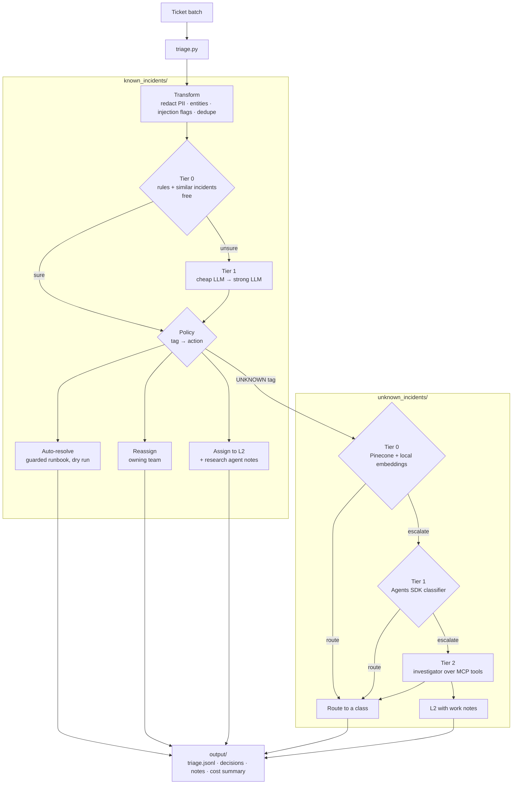

# Agentic Incident Triage

Agentic triage for IT support incidents, designed so that most tickets never touch an LLM.

Support teams see the same few problems over and over (a stuck batch job, a missing item file, a password reset)
plus a long tail of issues nobody has seen before. This repo handles the two differently:

- **Known incidents** match a cluster tag in a catalogue. Free rules and retrieval tag them, a cheap model helps
  only when those are unsure, and plain code decides the action: **auto-resolve** through a guarded runbook,
  **reassign** to the owning team, or **assign to L2** with AI research notes.
- **Unknown incidents** match no tag. They go through a three-tier cascade (vector retrieval, then an LLM
  classifier, then a tool-using investigator over a read-only MCP server), which routes the ticket or escalates
  it to L2 with evidence-backed work notes.

The known path runs fully offline with no API key, so you can clone the repo and see it work in a minute.

```text
INC1001  known    auto_resolve ASN_VOID          DRY RUN: would have set ASN 00000004321 to status 9 (voided)
INC1005  known    reassign     ACCESS_REQUEST    IAM - Access Management   (phone and email redacted first)
INC1008  known    assign_l2    POS_DOWN          note: pos_service stopped since 06:58, restart per KB0101
INC1011  known    assign_l2    ASN_VOID          possible prompt injection in the ticket text, needs a human
INC1012  known    duplicate    POS_DOWN          same issue as INC1008: linked, no LLM call
INC1014  unknown  ...                            no tag fits: sent to the investigation cascade
```

## Architecture



**The model proposes, the code decides.** On the known path an LLM only ever suggests a tag. What happens next
comes from [`cluster_tags.json`](known_incidents/config/cluster_tags.json) and [`policy.py`](known_incidents/policy.py),
which are reviewable config and code. An auto-resolve needs high confidence, the entities its runbook needs, a
passing read-only precondition check (for example, an ASN that was already received can't be voided) and no sign
of prompt injection. Anything short of that goes to an engineer, never closed by a guess.

## Agentic patterns and cost controls

| Pattern | Where | Why it keeps cost down or risk low |
|---|---|---|
| Tiered routing and model cascade | both paths | Each tier runs only when the cheaper one can't decide. On the sample batch, 11 of 15 known tickets are tagged with no model call. |
| Confidence gates tied to the action | `known_incidents/tier0.py`, `config.py` | Rules alone may reassign at 0.80 but need 0.90 to auto-resolve; below that, an LLM is asked and agreeing signals are combined. |
| Structured outputs | `models.py`, `llm.strict_schema`, Tier 1/2 decisions | Pydantic models and strict JSON schemas; a tag or class outside the list is rejected, never trusted. |
| Retrieval-augmented classification | `retriever.py` (TF-IDF), `unknown_incidents/tier0_triage.py` (Pinecone) | Similar resolved incidents go into the prompt; the known path's retriever needs no vector DB at all. |
| Tool-using agents | `research_agent.py`, `unknown_incidents/tier2_triage.py` | Read-only, allowlisted tools; hard turn caps (6 and 8); the last turn must answer; tool output truncated. |
| MCP tool server | `unknown_incidents/tier2_mcp_server.py` | The investigator's tools run in a separate process with read-only annotations and an allowlisted set of diagnostics. |
| Guardrails | `etl.py`, `policy.py` | PII redacted before any model sees the text; injection phrases flagged and auto-resolve blocked; ticket text fenced as untrusted data. |
| Human in the loop | `policy.py` | Runbooks are a dry run unless `--execute`; every failed guard, API error or budget cap ends in L2, not a guess. |
| Budget caps and cost tracking | `known_incidents/llm.py` | Per-run and per-ticket USD caps checked before every call; cost per model reported, cached-input tokens priced at the discount. |
| Response and prompt-prefix caching | `llm.py`, `tier1.py` | Identical requests come from a disk cache; the static prompt prefix is kept identical so the provider can bill it as cached input. |
| Incident-storm dedupe | `etl.group_duplicates` | Repeat reports of one issue are linked to the first, so 50 reports cost one triage. |
| Path hand-off | `triage.py` | Only `UNKNOWN` tickets reach the expensive cascade, capped by `--max-unknown`, and the known path skips its own research for them so nothing is paid twice. |
| Evaluation and LLM-as-judge | each folder's `evaluate.py` and `judge.py` | Labelled eval sets, a CI gate on wrong auto-resolves, a free grounding check on every note, and a judge with a self-test. |

## Quickstart

Python 3.10 or newer.

```bash
python3 -m venv .venv && source .venv/bin/activate
pip install -r requirements.txt
python triage.py                    # known path offline, no keys, $0
pytest -q                           # 19 offline tests
```

With keys, everything else switches on:

```bash
pip install -r requirements-unknown.txt
cp .env.example .env                # add OPENAI_API_KEY and PINECONE_API_KEY
python -m unknown_incidents.tier0_triage --load       # one time: build the Pinecone index
python triage.py --provider openai --max-unknown 10   # real models on both paths
```

`triage.py` uses the unknown path automatically when both keys and its packages are present (`--unknown auto`,
the default); `--unknown off` keeps every ticket on the known path. It writes `output/triage.jsonl` (one line per
ticket with the path it took), the known path's `decisions.jsonl`, `l2_notes/` and `run_summary.json`, which also
reports the unknown path's counts and cost.

## Evals

Each folder evaluates itself and keeps its saved results, so every change can be compared with a baseline.

| Path | Command | Eval set | Saved baseline |
|---|---|---|---|
| Known | `python -m known_incidents.evaluate` | 15 labelled tickets | Offline run: tag and action accuracy 100%, 0 wrong auto-resolves, every L2 note's findings backed by a tool output |
| Unknown | `python -m unknown_incidents.evaluate` | 15 labelled tickets | Tier 0 alone at a 0.80 threshold: routed 3 of 15, all correct, escalated the other 12 |
| Unknown | `python -m unknown_incidents.evaluate --sweep` | same | Threshold sweep: 0.50 routes 7 with 0 wrong; 0.90 routes 2 |

Read the known-path baseline for what it is: offline mode swaps the LLM for a deterministic, rule-based stand-in
tuned to these 15 tickets. It proves the pipeline, guards, budget and evaluation code work end to end; it says
nothing about real-model accuracy. Run `python -m known_incidents.evaluate --provider openai --judge` for that.
The unknown-path results come from real Tier 0 retrieval; run `--max-tier 2 --judge` for the full cascade, after
`python -m unknown_incidents.judge --selftest`. CI runs the offline tests and fails the build on any wrong
auto-resolve.

## Project layout

```text
triage.py                    entry point: known path first, UNKNOWN tickets to the cascade
known_incidents/             known path, self-contained
  config/cluster_tags.json   tag catalogue + routing policy
  data/                      sample tickets (with labels), history, KB, stand-in system data
  etl.py tier0.py tier1.py   transform, free tier, LLM cascade
  policy.py tools.py         actions + guarded runbooks, read-only tools
  research_agent.py          L2 research notes
  llm.py offline.py          model gateway (budget, cache, cost, OpenAI) and the no-key stand-in
  run.py evaluate.py judge.py tests/ eval_results/
unknown_incidents/           unknown path, self-contained
  tier0_triage.py            Pinecone + fastembed retrieval
  tier1_triage.py            Agents SDK classifier
  tier2_triage.py            MCP investigator; triage_async runs the cascade
  tier2_mcp_server.py        read-only MCP tools
  evaluate.py judge.py eval_set.jsonl eval_results/
tests/                       tests for the hand-off, with a fake cascade
requirements.txt             known path + tests
requirements-unknown.txt     adds the unknown path's packages
.env.example                 every setting; copy to .env (never committed)
```

Each folder has its own README with every command: [known_incidents](known_incidents/README.md),
[unknown_incidents](unknown_incidents/README.md).

## Limitations

- All data is synthetic, and both eval sets have only 15 tickets. They show the method, not production accuracy.
- The OpenAI adapter on the known path is tested against a fake client, not the live API.
- The unknown path needs OpenAI and Pinecone keys, so CI does not run it; only the hand-off is tested, with a fake cascade.
- The two paths use different label sets: the cascade still routes to its own class names, not the known path's cluster tags.
- The known path's USD caps don't cover the unknown path; there, `--max-unknown` limits spend and the summary reports it.
- Runbooks and diagnostic tools read stand-in data; connecting real ticketing, KB and monitoring systems is left to the adopter.