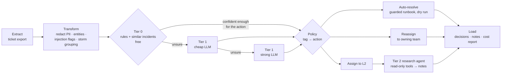

# known_incidents

The known-incident path of [agentic-incident-triage](../README.md): a low-cost, agentic triage pipeline for IT
support tickets that match a known **cluster tag**. It reads a batch of incidents, tags each one, and then does one of
four things:

| Outcome | When | Example from the sample data |
|---|---|---|
| **Auto-resolve** | a safe runbook exists, confidence is high, and a read-only precondition check passes | void an ASN that was never received |
| **Reassign** | the ticket belongs to another team | password reset → IAM, network down → NOC |
| **Assign to L2 with AI research notes** | an engineer is needed | registers can't scan: notes say `pos_service` stopped at 06:58 and cite KB0101 |
| **Link as duplicate** | same issue reported again (incident storm) | second "registers can't scan" ticket from the same store |

Tickets no tag fits come out as `UNKNOWN`. Run alone, this package writes its own L2 research notes for them; run
through `triage.py` at the repo root, they are handed to [`unknown_incidents/`](../unknown_incidents/README.md)
instead. **This path runs fully offline with no API key.** All commands below run from the repo root.

```bash
pip install -r requirements.txt
python -m known_incidents.run        # triage the 15 sample tickets, offline, $0
python -m known_incidents.evaluate   # score against labels, saves known_incidents/eval_results/
pytest -q known_incidents/tests      # 17 tests, no network
```

## How it works



The key design rule is **the model proposes, the policy decides**. LLMs only ever suggest a cluster tag (or write
notes). What happens to the ticket comes from [`config/cluster_tags.json`](config/cluster_tags.json) and
[`policy.py`](policy.py), which are plain, reviewable code and config.

## Agentic patterns used, and why each one keeps cost down

| Pattern | Where | Cost effect |
|---|---|---|
| **Tiered routing / model cascade** | `tier0.py` → `tier1.py` | Rules and retrieval decide most tickets for free. The cheap model sees only what rules couldn't decide; the strong model only what the cheap one was unsure of. |
| **Confidence gates tied to the action** | `Catalogue.min_confidence` | Tier 0 answers alone only when its confidence clears the bar for the action its tag would trigger; otherwise it asks Tier 1, and agreement of the two signals is combined. |
| **Structured outputs** | `models.py`, `llm.strict_schema` | Pydantic models + strict JSON schema: no parsing retries, invalid tags become `UNKNOWN`. |
| **Tool-using agent (ReAct loop)** | `research_agent.py`, `tools.py` | Runs only for L2 tickets. Read-only, allowlisted tools; parallel tool calls; hard turn cap; final turn forces an answer; outputs truncated. |
| **Retrieval-augmented context** | `retriever.py` | Similar resolved incidents go into the prompt. Pure-Python TF-IDF, no vector DB bill. |
| **Guardrails** | `etl.py`, `policy.py` | PII redacted before any LLM call; prompt-injection phrases flag the ticket and block auto-resolve; ticket text is fenced as untrusted data. |
| **Guarded actions (human in the loop)** | `policy.py` | Auto-resolve needs: high confidence, required entities, a passing precondition check, no injection flag. Runbooks are a dry run unless `--execute`. Every miss goes to L2, never closed by a guess. |
| **Budget caps + cost tracking** | `llm.Budget` | Per-run and per-ticket USD caps checked before every call. Hitting a cap degrades to "assign to L2", it doesn't crash. Cost per model is reported. |
| **Response cache** | `llm.LLM` | Identical classification/judge requests are served from disk: re-runs and backfills are free. |
| **Prompt-prefix caching** | `tier1.system_prompt` | Static rules + tag catalogue go first and never change, so providers that cache prefixes bill them at the cached-input rate (OpenAI does this automatically above ~1,024 tokens; the cost model counts cached tokens at the discount). |
| **Storm deduplication** | `etl.group_duplicates` | 50 tickets about one outage cost one triage, not 50. |
| **Cross-ticket correlation** | `list_open_tickets` tool | The agent sees other open tickets for the same store, so "kiosk rebooting" gets linked to "store network down". |
| **Evaluation + LLM-as-judge** | `evaluate.py`, `judge.py` | Labelled eval set, a CI gate on wrong auto-resolves, a free deterministic grounding check on every note, and an optional cheap-model judge for actionability. |

## Sample run (offline)

```text
ticket   action       cluster tag        conf  decided by                     cost  assigned to
INC1001  auto_resolve ASN_VOID           0.95  tier0                      $0.00000  Store Systems - Item and Receiving
         └ DRY RUN: would have set ASN 00000004321 (ACME Foods) to status 9 (voided)
INC1004  assign_l2    ITEM_FILE_MISSING  0.95  tier0                      $0.00000  Store Systems - Item and Receiving
         └ ITEM_FILE_MISSING runbook precondition failed: store 2111 item file is only 3h old, so a re-send would not help
INC1005  reassign     ACCESS_REQUEST     0.85  tier0                      $0.00000  IAM - Access Management
INC1011  assign_l2    ASN_VOID           0.95  tier0                      $0.00000  Store Systems - Item and Receiving
         └ possible prompt injection in the ticket text, needs a human
INC1012  duplicate    POS_DOWN           0.85  storm grouping             $0.00000  Store Systems - L2
INC1013  auto_resolve ASN_VOID           0.98  tier0+tier1:offline-small  $0.00000  Store Systems - Item and Receiving
...
15 tickets: {'auto_resolve': 4, 'assign_l2': 7, 'reassign': 3, 'duplicate': 1}
PII redactions 2, injection flagged ['INC1011'], runbooks in DRY RUN
```

And the research note written for the L2 engineer on `INC1008` (`output/l2_notes/INC1008.md`):

```markdown
**Suspected cause** (confidence 80%): pos_service on store 2111 is stopped since 06:58

## What the agent checked
- Runbook 'POS service down: registers cannot scan or sell': ... _(source: KB0101)_
- Similar incident 'Registers cannot scan, POS service stopped at store' was resolved by:
  L2 restarted pos_service from the store server console _(source: INC0501)_
- Other open tickets for this store: INC1002 'Alert BATCH01 process hung', ... _(source: list_open_tickets)_
- pos_service on store 2111: stopped since 06:58 _(source: run_store_diagnostic)_

## Suggested next steps
1. If pos_service is stopped, L2 restarts it from the store server console, then confirms a test scan (KB0101).
2. If it stops again, check for a recent patch (KB0101).
```

## Running with a real model

```bash
cp .env.example .env                                  # add OPENAI_API_KEY, set LLM_PROVIDER=openai
python -m known_incidents.run --max-run-usd 0.10      # hard cap for the whole run
python -m known_incidents.evaluate --judge            # adds an LLM judge on the research notes
```

The OpenAI adapter uses the Responses API with strict structured outputs and function calling, and continues
tool loops with `previous_response_id`. Model names, caps and the judge model are all set in `.env`.

**Rough cost.** On `gpt-4o-mini`, a Tier 1 classification is about 600 input / 80 output tokens (≈ $0.00014) and
a Tier 2 investigation about 3 turns and 5k input / 600 output tokens (≈ $0.001). If ~20% of tickets need Tier 1
and ~45% go to L2, that is on the order of **$0.50 per 1,000 tickets**. These are estimates: `run_summary.json`
reports the real token counts and cost per model for your data.

## Offline mode

`LLM_PROVIDER=offline` swaps the model for `offline.py`, a deterministic rule-based stand-in that speaks
the same protocol, including multi-turn tool calls. The agent loop, budget, tracing, policy and evaluation code
all run for real; only the "thinking" is heuristic. It exists so the repo runs and is testable without a key.
Its scores on the bundled 15 tickets are tuned to that data and say nothing about real-model accuracy.

## Project layout

```text
known_incidents/
  config/cluster_tags.json tag catalogue + routing policy (action, team, runbook, required entities)
  data/                    sample tickets (with eval labels), resolved history, KB, system snapshots
  etl.py                   extract · transform (PII, entities, injection, storms) · load
  tier0.py                 rules + similar-incident vote (free)
  tier1.py                 LLM classification, cheap → strong cascade
  policy.py                tag → action, guarded runbooks
  research_agent.py        Tier 2 tool loop → ResearchNotes
  tools.py                 read-only tools with an allowlist
  llm.py                   gateway: budget, cost, cache, OpenAI adapter
  offline.py               no-key stand-in provider
  judge.py                 grounding check + LLM-as-judge
  pipeline.py              orchestration and fallbacks
  run.py · evaluate.py     CLIs (python -m known_incidents.run / .evaluate)
  eval_results/            saved eval runs; the committed one is the offline baseline
  tests/                   offline tests, including a fake OpenAI client for the tool loop
```

## Taking it toward production

- Replace the sample data in `tools.py` with ServiceNow, your KB search and real diagnostics, keeping tools read-only.
  Write actions belong only in runbooks behind `policy.py`.
- Swap `retriever.py` for embeddings and a vector store once history is large (same `search` interface).
- Grow `data/tickets.jsonl` into a real labelled eval set from closed tickets, and keep the
  `--max-wrong-auto 0` gate in CI.
- For non-urgent backfills, the provider's batch API (about half price) fits the same `LLMRequest` shape.
- Expose the tools over MCP if other agents should share them.
