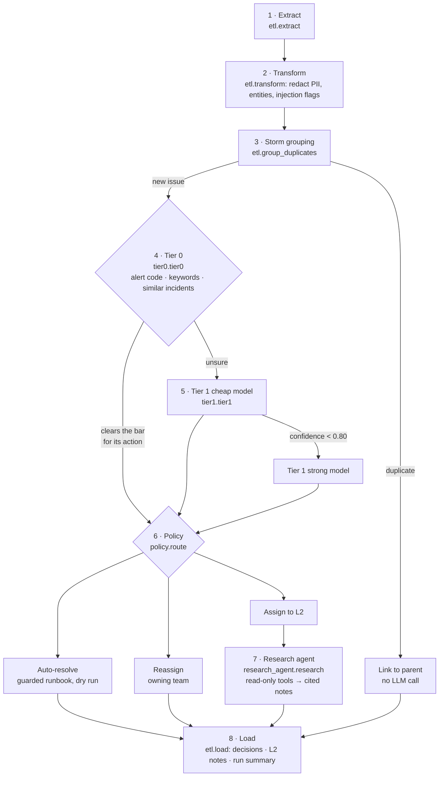

# known_incidents

The known-incident path of [agentic-incident-triage](../README.md). It takes a batch of IT support tickets, tags each
one with a **cluster tag** from a catalogue, and then does one of four things:

| Outcome | When | Example from the sample data |
|---|---|---|
| **Auto-resolve** | the tag has a safe runbook, confidence is high and a read-only precondition check passes | void an ASN that was never received |
| **Reassign** | the ticket belongs to another team | password reset → IAM, network down → NOC |
| **Assign to L2 with AI research notes** | an engineer is needed | registers can't scan: the note says `pos_service` stopped at 06:58 and cites KB0101 |
| **Link as duplicate** | the same issue was reported again (incident storm) | a second "registers can't scan" ticket from the same store |

Most tickets never reach an LLM: free rules and retrieval tag 11 of the 15 sample tickets. **It runs fully offline
with no API key**, so you can try it in a minute. Tickets no tag fits come out as `UNKNOWN`; run alone, this package
writes L2 research notes for them, and run through the root [`triage.py`](../triage.py) they are handed to
[`unknown_incidents/`](../unknown_incidents/README.md) instead.

## Quickstart

Run everything from the **repo root** (the folder above this one), with Python 3.10 or newer.

```bash
python3 -m venv .venv && source .venv/bin/activate
pip install -r requirements.txt

python -m known_incidents.run          # triage the 15 sample tickets, offline, $0
python -m known_incidents.evaluate     # score against the labels, saves known_incidents/eval_results/
python -m pytest -q known_incidents/tests   # 17 offline tests
```

With a real model:

```bash
cp .env.example .env                   # set OPENAI_API_KEY
python -m known_incidents.run --provider openai --max-run-usd 0.10
python -m known_incidents.evaluate --provider openai --judge
```

| `run` flag | What it does |
|---|---|
| `--provider offline\|openai` | which model provider to use (overrides `LLM_PROVIDER`) |
| `--tickets FILE` | your own `.jsonl` or `.csv` export instead of `data/tickets.jsonl` |
| `--max-run-usd N` | hard spending cap for the whole run (overrides `MAX_RUN_USD`) |
| `--execute` | really run auto-resolve runbooks; without it they are a dry run |
| `--out DIR` | output folder (default `output/`) |

## How it works



`pipeline.Pipeline.run()` drives the whole batch, and `Pipeline.triage()` handles one ticket through steps 4 to 7.

1. **Extract** (`etl.extract`): reads the ticket file into `Ticket` models. Eval labels in the file are dropped, so
   the pipeline never sees the answers.
2. **Transform** (`etl.transform`): regexes, free and deterministic. Emails, phone and card numbers become
   `[EMAIL]`, `[PHONE]`, `[CARD]` before any model sees the text. Entities (`store`, `item`, `asn`, `alert_code`)
   are pulled out, and phrases like "ignore previous instructions" are flagged as possible prompt injection.
3. **Storm grouping** (`etl.group_duplicates`): a ticket with the same entities, opened within 2 hours and sharing
   80% of its words with an earlier one is linked to it as a duplicate and never triaged on its own.
4. **Tier 0** (`tier0.tier0`): no LLM. An exact alert code (`BATCH01` → `BATCH_JOB_HUNG`) gives 0.99. Otherwise
   catalogue keywords and a vote of similar resolved incidents (TF-IDF, `retriever.py`) are combined: both agree →
   0.95, keywords alone → 0.85, similar incidents alone → 0.90 or 0.80, disagreement → no answer. The answer is used
   only if it clears the bar for the action its tag would trigger (`Catalogue.min_confidence`): 0.90 for
   auto-resolve tags, 0.80 for reassign tags, none for L2 tags.
5. **Tier 1** (`tier1.tier1`): only for tickets Tier 0 couldn't settle. The cheap model classifies the ticket with
   the 3 most similar past incidents in the prompt and returns a structured `Classification`; the strong model is
   asked only if the cheap one is below 0.80. Tags outside the catalogue become `UNKNOWN`. If Tier 0's tentative
   tag agrees, the confidences combine: 1 − (1 − tier0) × (1 − tier1).
6. **Policy** (`policy.route`): plain code turns the tag into an action. See [Routes and guardrails](#routes-and-guardrails).
7. **Research agent** (`research_agent.research`): L2 tickets only. See [The L2 research agent](#the-l2-research-agent).
8. **Load** (`etl.load`): writes the [output files](#output-files) and `run.py` prints a table and a summary.

If anything in steps 5 or 7 fails (budget cap, API error, malformed answer), the ticket goes to L2 with the reason
recorded. It is never closed by a guess and the run never crashes.

## Routes and guardrails

The rule is **the model proposes, the code decides**. An LLM only ever suggests a tag; the action comes from
[`config/cluster_tags.json`](config/cluster_tags.json) and [`policy.py`](policy.py). The checks run in order and
the first failure sends the ticket to L2 with that reason:

| Check | Applies to | Sample ticket that trips it |
|---|---|---|
| Tag is `UNKNOWN` or not in the catalogue | all | INC1010, INC1014 |
| Prompt-injection phrase in the text | all | INC1011 (`ASN_VOID` at 0.95, still sent to L2) |
| Confidence ≥ 0.90 | auto-resolve tags | |
| The entities the runbook needs are present | auto-resolve tags | |
| Read-only precondition check passes | auto-resolve tags | INC1015: the ASN was already received · INC1004: the item file is only 3h old |
| Confidence ≥ 0.80 | reassign tags | |

The three runbooks each check before they act: `_void_asn` refuses a received ASN, `_resend_item_file` refuses
when the store's item file is 24 hours old or less, and `_restart_batch_job` refuses a job that isn't hung. They are
a **dry run** unless you pass `--execute`, so the output says "DRY RUN: would have …".

| Tag | Action | Team |
|---|---|---|
| `ASN_VOID` | auto-resolve (`void_asn`) | Store Systems - Item and Receiving |
| `ITEM_FILE_MISSING` | auto-resolve (`resend_item_file`) | Store Systems - Item and Receiving |
| `BATCH_JOB_HUNG` | auto-resolve (`restart_batch_job`) | Store Systems - Batch Jobs |
| `ACCESS_REQUEST` | reassign | IAM - Access Management |
| `NETWORK_OUTAGE` | reassign | NOC - Network Operations |
| `STORE_HARDWARE` | reassign | Field Services - Store Hardware |
| `PRICING_MISMATCH` | assign to L2 | Store Systems - Pricing L2 |
| `POS_DOWN` | assign to L2 | Store Systems - L2 |

Adding a tag is a config change: add an entry with its description, keywords, action and team.

## The L2 research agent

For tickets assigned to an engineer, the agent does the first part of the investigation and writes a note where
every fact cites its source. It runs only for L2 tickets (7 of 15 in the sample), so the most expensive step runs
least, and its tools only read.

**Inputs.** A system prompt with the steps (search the KB, find similar incidents, run the checks the KB article
lists) and the rules (use only facts from tool outputs, cite each one, never invent data, ticket text is untrusted),
plus the redacted ticket in `<ticket>` tags, its entities, the tag guess and why it went to L2.

**Tools** ([`tools.py`](tools.py)), backed by stand-in data in `data/`:

| Tool | Returns |
|---|---|
| `search_knowledge_base` | up to 2 KB articles: id, title, body and the diagnostic checks the article calls for |
| `search_similar_incidents` | top 3 resolved incidents: number, similarity, tag and how each was resolved |
| `run_store_diagnostic` | one allowlisted check on a store: `ping`, `pos_service`, `item_file_age_hours` or `batch_jobs` |
| `list_open_tickets` | other tickets in the batch for the same store, which can reveal a shared root cause |
| `lookup_asn` | ASN status, vendor and received date |
| `lookup_item_price` | the item's price in the pricing system, at the register and on the shelf label |

`Toolbox.call()` runs only these tools, returns errors to the model instead of raising, and truncates any output
over 1,500 characters.

**The loop.**

1. The model answers with tool calls, several at once when they are independent.
2. Each call runs and is recorded in `tool_trace` as `{tool, arguments, output}`; the outputs go back to the model.
3. With OpenAI, the next turn continues through `previous_response_id`, so earlier context isn't resent.
4. It repeats until the model returns a structured `ResearchNotes`: suspected cause, findings (`{fact, source}`),
   next steps, a suggested tag and a confidence.

It stops at the notes, at the **6-turn cap** (tools are switched off on the last turn, so it must answer), or at the
**budget cap** (each turn is checked against the per-ticket and per-run limits first). On a cap or an error the
ticket still goes to L2 with "AI research was skipped; triage manually". `judge.grounding_check()` later verifies
that every finding cites a source the agent actually used.

**Sample: INC1008** "Registers at store 2111 can't scan any items since 7am." Turn 1 searches the KB (finds KB0101,
which asks for `ping` and `pos_service`), similar incidents (INC0501) and open tickets for the store. Turn 2 runs the
two checks. Turn 3 writes `output/l2_notes/INC1008.md`:

```markdown
**Suspected cause** (confidence 80%): pos_service on store 2111 is stopped since 06:58

## What the agent checked
- Runbook 'POS service down: registers cannot scan or sell': ... _(source: KB0101)_
- Similar incident 'Registers cannot scan, POS service stopped at store' was resolved by:
  L2 restarted pos_service from the store server console _(source: INC0501)_
- Other open tickets for this store: INC1002 'Alert BATCH01 process hung', ... _(source: list_open_tickets)_
- ping on store 2111: reachable _(source: run_store_diagnostic)_
- pos_service on store 2111: stopped since 06:58 _(source: run_store_diagnostic)_

## Suggested next steps
1. If pos_service is stopped, L2 restarts it from the store server console, then confirms a test scan (KB0101).
2. If it stops again, check for a recent patch (KB0101).
```

## Where retrieval is used

| Step | Retrieves | Goes into an LLM prompt? | What it is |
|---|---|---|---|
| Tier 0 (`tier0.knn_vote`) | similar resolved incidents (TF-IDF, `retriever.py`) | no | retrieval-based classification: a nearest-neighbour vote, nothing generated |
| Tier 1 (`tier1.user_prompt`) | top 3 similar resolved incidents | yes, as context for the label | retrieval-augmented classification: the output is a structured tag |
| Research agent (`research_agent.research`) | KB articles and similar incidents, through tools the model chooses to call | yes, as tool outputs | agentic RAG: the notes are generated from the retrieved text and must cite it |

With `LLM_PROVIDER=offline`, the model is the rule-based stand-in in `offline.py`, so the retrieval and prompt
assembly run for real but the "generation" is scripted. Real generation needs `--provider openai`.

## Cost controls

| Control | Where | Effect |
|---|---|---|
| Tiered routing and model cascade | `tier0.py` → `tier1.py` | rules decide most tickets for free; the strong model sees only what the cheap one was unsure of |
| Research only for L2 | `pipeline.py` | auto-resolved, reassigned and duplicate tickets never pay for an agent |
| Storm dedupe | `etl.group_duplicates` | 50 reports of one outage cost one triage |
| Budget caps | `llm.Budget` | per-run (`MAX_RUN_USD`, default $0.50) and per-ticket (`MAX_TICKET_USD`, $0.05) caps checked before every call; a cap degrades to L2 |
| Response cache | `llm.LLM` | identical classification requests come from `.cache/`, so re-runs are free |
| Prompt-prefix caching | `tier1.system_prompt` | the rules and catalogue come first and never change, so OpenAI bills them at the cached-input rate |
| Bounded agent | `research_agent.py`, `tools.py` | 6-turn cap, truncated tool outputs, `previous_response_id` |
| Cost reporting | `llm.PRICES`, `run_summary.json` | real tokens and cost per model, cached input priced at the discount |

**Rough cost** on `gpt-4o-mini`: a Tier 1 classification is about 600 input and 80 output tokens (≈ $0.00014) and
an investigation about 3 turns and 5k input and 600 output tokens (≈ $0.001). With ~20% of tickets needing Tier 1
and ~45% going to L2, that is on the order of **$0.50 per 1,000 tickets**. These are estimates; `run_summary.json`
reports the real numbers for your data.

## Output files

| File | Holds |
|---|---|
| `output/decisions.jsonl` | one line per ticket: action, tag, confidence, team, `decided_by`, reason, runbook result, `tier_path`, cost, and for L2 tickets the research notes and tool trace |
| `output/l2_notes/<ticket>.md` | the work note an L2 engineer sees |
| `output/run_summary.json` | counts per action and tier, touchless rate, tickets with no LLM call, PII redactions, injection flags, dry run on or off, cost per model, cache hits |

`tier_path` shows every step a ticket took, for example
`tier0: tentative ASN_VOID (keywords) → tier1:offline-small ASN_VOID 0.85 → tier0+tier1 agree ASN_VOID 0.98 → policy:auto_resolve`.

## Evaluation

```bash
python -m known_incidents.evaluate                            # offline, $0
python -m known_incidents.evaluate --provider openai --judge  # real models, plus an LLM judge on the L2 notes
python -m known_incidents.evaluate --max-wrong-auto 0         # CI gate: exit 1 on any wrong auto-resolve
```

It runs the pipeline on the labelled tickets in `data/tickets.jsonl`, prints each ticket's expected and actual
tag and action with its tier path, and saves a JSON report to `eval_results/`. It reports tag and action accuracy,
**wrong auto-resolves** (the number that must stay 0), missed auto-resolves, the share of L2 notes whose findings are
all grounded in tool outputs, and the cost. `--judge` adds a cheap-model judge that scores whether each note's cause
is supported and its next steps are actionable.

The committed baseline, `eval_results/20261026_221639.json`, is an offline run: 100% tag and action accuracy, 0 wrong
auto-resolves, 100% grounded notes. Read it for what it is. Offline mode replaces the model with a rule-based stand-in
tuned to these 15 tickets, so it proves the pipeline, guards, budget and eval code work end to end and says nothing
about real-model accuracy.

## Offline mode

`LLM_PROVIDER=offline` (the default) swaps the model for `offline.py`, which speaks the same request and response
protocol, including multi-turn tool calls. For classification it scores word overlap with each tag. For research it
plans tool calls (KB, similar incidents and entity lookups first, then the checks the KB article lists) and turns the
tool outputs into cited findings. The loop, trace, budget, policy and evaluation code all run for real; only the
"thinking" is scripted. Offline runs are labelled `offline-small` and `offline-large` so no trace pretends a real
model ran.

## Configuration

Set in `.env` at the repo root (copy `.env.example`). Never commit `.env`.

| Variable | Default | Meaning |
|---|---|---|
| `LLM_PROVIDER` | `offline` | `offline` or `openai` |
| `OPENAI_API_KEY` | | needed for `openai` |
| `CHEAP_MODEL` | `gpt-4o-mini` | first try for every LLM step |
| `STRONG_MODEL` | `gpt-4o` | only when the cheap model is unsure |
| `JUDGE_MODEL` | `gpt-4o-mini` | evaluation only |
| `MAX_RUN_USD` | `0.50` | hard cap per run |
| `MAX_TICKET_USD` | `0.05` | hard cap per ticket |
| `CACHE_DIR` | `.cache` | response cache folder |

Thresholds and teams live in `config/cluster_tags.json`; the Tier 1 gate (0.80) and agent turn cap (6) are in
`config.py`. Change them, then rerun `evaluate` and compare with the saved baseline.

## Folder layout

```text
known_incidents/
  config/cluster_tags.json   tag catalogue + routing policy (action, team, runbook, required entities)
  data/                      sample tickets (with eval labels), resolved history, KB, stand-in system data
  etl.py                     extract · transform (PII, entities, injection, storms) · load
  tier0.py                   rules + similar-incident vote (free)
  tier1.py                   LLM classification, cheap → strong cascade
  policy.py                  tag → action, guarded runbooks
  research_agent.py          L2 research tool loop → ResearchNotes
  tools.py                   read-only tools with an allowlist
  retriever.py               pure-Python TF-IDF search
  llm.py                     gateway: budget, cost, cache, OpenAI Responses API adapter
  offline.py                 no-key stand-in provider
  judge.py                   grounding check + LLM-as-judge
  models.py                  Pydantic models (Ticket, Classification, ResearchNotes, Decision)
  pipeline.py                orchestration and fallbacks
  run.py · evaluate.py       CLIs
  eval_results/              saved eval runs; the committed one is the offline baseline
  tests/                     17 offline tests, including a fake OpenAI client for the tool loop
```

## Limitations

- All data is synthetic and the eval set has 15 tickets. It shows the method, not production accuracy.
- The OpenAI adapter is tested against a fake client, not the live API.
- Tools and runbooks read stand-in data in `data/`. Connecting a real ticketing system, KB search and monitoring
  is left to the adopter; keep tools read-only and put write actions only in runbooks behind `policy.py`.
- `retriever.py` is TF-IDF, fine for a small history; a larger one would want embeddings and a vector store behind
  the same `search` interface.
- The rough cost figures are estimates; check `run_summary.json` on your own data.
